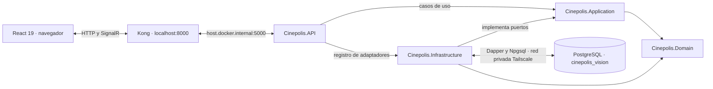
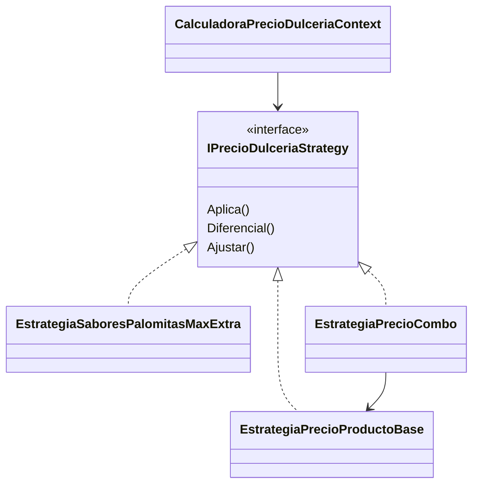
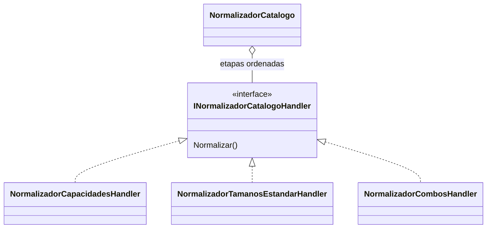
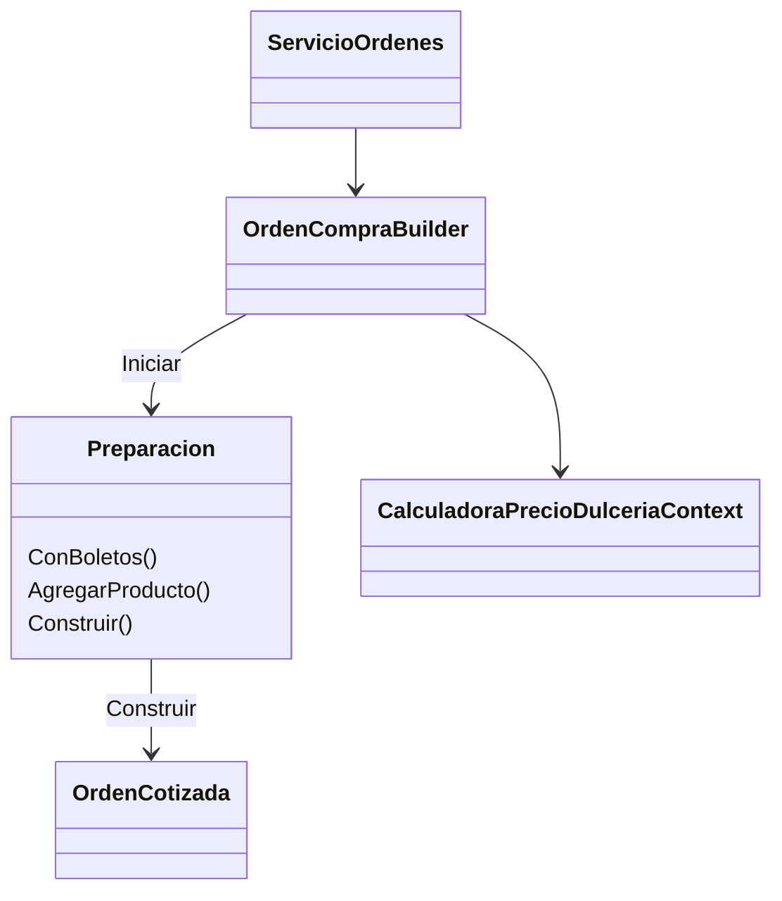
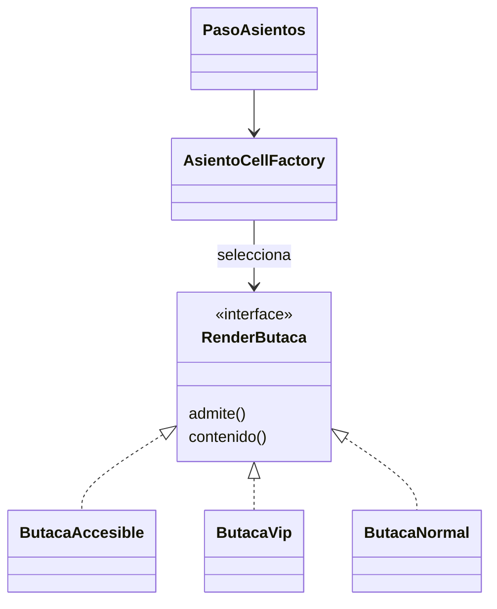
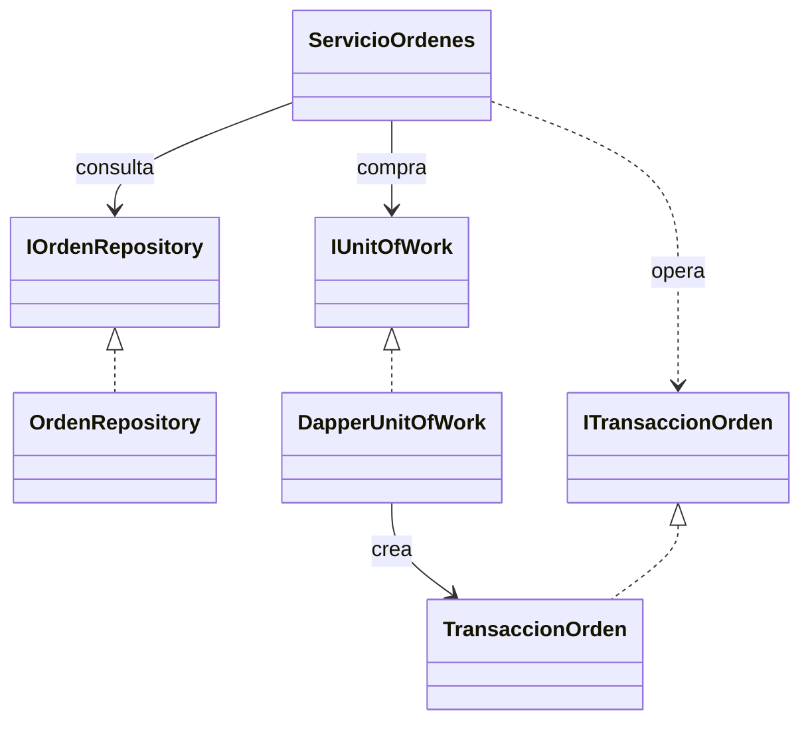
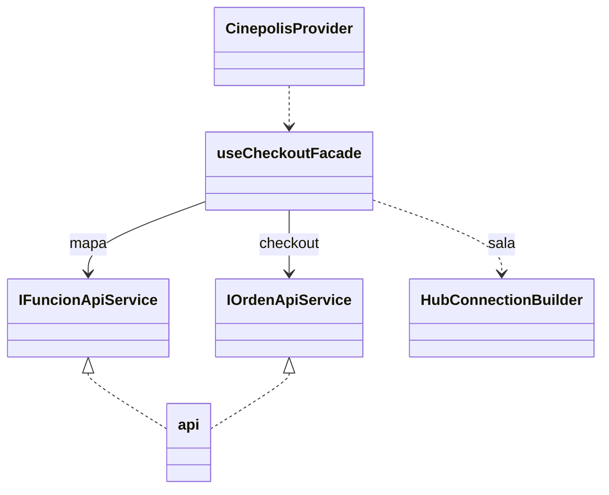

# Cinépolis · Cartelera, reserva de asientos y venta en línea

## 1. Descripción general y alcance

Clon académico funcional y arquitectónico de Cinépolis. El hilo conductor es la compra de una función en un complejo real, como Cinépolis Acaya Coatzacoalcos. La ciudad y el complejo determinan qué horarios, tarifas y productos puede elegir el visitante. PostgreSQL conserva la disponibilidad compartida entre espectadores.

| Etapa | Experiencia del espectador | Evidencia técnica |
|---|---|---|
| Cartelera y ficha | Consulta funciones por cine, fecha, formato e idioma. La ficha reúne sinopsis, duración, tráiler, directores y reparto. | La consulta distingue actores y directores por su rol en `public.pelicula_persona`. [CarteleraRepository.cs](backend/Cinepolis.Infrastructure/CarteleraRepository.cs) |
| Boletos y sala | Elige tarifas, localiza la pantalla y selecciona butacas numeradas en su posición física. Otros navegadores reciben los cambios de la misma función. | [AsientoRepository.cs](backend/Cinepolis.Infrastructure/AsientoRepository.cs) · [SalaHub.cs](backend/Cinepolis.API/SalaHub.cs) · [PasoAsientos.tsx](frontend/src/pages/compra/PasoAsientos.tsx) |
| Dulcería | Personaliza cada componente del combo según el catálogo regional y ve cómo cambia el total. | [DulceriaRepository.cs](backend/Cinepolis.Infrastructure/DulceriaRepository.cs) · [useConfigurador.ts](frontend/src/hooks/useConfigurador.ts) |
| Checkout | Compra como invitado o socio. El servidor verifica reservas y precios, persiste la venta y entrega un folio con contenido protegido para el QR. La opción de tarjeta es de prueba. | [ServicioOrdenes.cs](backend/Cinepolis.Application/Ordenes/ServicioOrdenes.cs) · [GeneradorQr.cs](backend/Cinepolis.Infrastructure/Ordenes/GeneradorQr.cs) · [usePago.ts](frontend/src/hooks/usePago.ts) · [ConfirmacionPage.tsx](frontend/src/pages/ConfirmacionPage.tsx) |
| Club | Acceso por código de correo, perfil, visitas, puntos, historial y recuperación de boletos. | [AccesoClub.cs](backend/Cinepolis.Application/Club/AccesoClub.cs) · [ConsultarClub.cs](backend/Cinepolis.Application/Club/ConsultarClub.cs) · [ClubCinepolisPage.tsx](frontend/src/pages/ClubCinepolisPage.tsx) |

## 2. Stack tecnológico e infraestructura

| Tecnología | Versión o configuración verificada | Responsabilidad |
|---|---|---|
| React y React DOM | 19.3.1 | Componentes, estado y renderizado del cliente. |
| TypeScript y Vite | 5.9.3 y 7.3.8 | Contratos estáticos, servidor de desarrollo y empaquetado. |
| Tailwind CSS | 4.3.5, con `@tailwindcss/vite` 4.3.5 | Utilidades CSS que conviven con estilos propios del cine y de la compra. |
| SignalR y QR en React | `@microsoft/signalr` 8.0.29 y `qrcode.react` 4.2.0 | Suscripción por función y representación gráfica del comprobante. |
| C# y ASP.NET Core | Los cuatro proyectos apuntan a `net8.0` y habilitan referencias anulables | Kestrel, HTTP, SignalR nativo, autenticación JWT y Data Protection. Swagger está habilitado en desarrollo. |
| Dapper y Npgsql | 2.1.66 y 8.0.8 | SQL y mapeo de resultados sobre un pool de conexiones. La fábrica activa `DefaultTypeMap.MatchNamesWithUnderscores` y registra conversiones para fechas y horas antes de abrir conexiones. |
| PostgreSQL | Servidor 18.7, base `cinepolis_vision`, esquema `public` | Fuente de verdad para catálogo, tarifas, reservas y ventas. Versión consultada con `current_setting('server_version')`. El diccionario del proyecto describe 50 tablas. |
| Tailscale | Versión administrada por el entorno | Conectividad privada entre el host de la API y el servidor remoto. El host y el puerto se resuelven mediante la cadena Npgsql de la instalación. |
| Kong Gateway y Docker Compose | Imagen `kong:3.9`, formato declarativo `3.0` | Proxy en el puerto 8000, con la administración desactivada y la configuración montada en modo lectura. Compose levanta el gateway. |

Las versiones del cliente corresponden al archivo de bloqueo. Las referencias de .NET y las rutas del gateway están declaradas en los archivos del proyecto. [package-lock.json](frontend/package-lock.json) · [Cinepolis.API.csproj](backend/Cinepolis.API/Cinepolis.API.csproj) · [Cinepolis.Infrastructure.csproj](backend/Cinepolis.Infrastructure/Cinepolis.Infrastructure.csproj) · [docker-compose.yml](docker-compose.yml) · [kong.yml](kong.yml)

## 3. Arquitectura del sistema



Las flechas entre proyectos indican dependencias de compilación. Al ejecutar una compra, la aplicación invoca el puerto transaccional y el contenedor de inyección le proporciona el adaptador PostgreSQL. El recorrido de vuelta al navegador pasa por SignalR después del commit. [Program.cs](backend/Cinepolis.API/Program.cs) · [ServicioOrdenes.cs](backend/Cinepolis.Application/Ordenes/ServicioOrdenes.cs)

| Capa física | Decisión que le corresponde |
|---|---|
| `backend/Cinepolis.Domain` | Define entidades, vocabularios persistidos, políticas de precio, folio de compra y puertos de dominio para películas y reservas. Es independiente de los demás proyectos. |
| `backend/Cinepolis.Application` | Organiza consultas y compras, define DTO y puertos, normaliza el catálogo y coordina el armado de órdenes. Depende de Domain. |
| `backend/Cinepolis.Infrastructure` | Implementa los puertos con SQL parametrizado, Dapper y Npgsql. También implementa correo OTP y protección del contenido del QR. Referencia Application y Domain. |
| `backend/Cinepolis.API` | Compone servicios, expone controladores y hub, mapea conflictos a HTTP 409 y ejecuta la limpieza de reservas. Referencia Application e Infrastructure. |
| `frontend/src/types` | Contratos del API, tipos del carrito y puertos específicos para los consumidores. |
| `frontend/src/services` | Cliente HTTP, transformación de sesiones, tarifas, geometría, reglas de selección y políticas de precio. |
| `frontend/src/hooks` | Ciclo de vida y acciones por pantalla, suscripción a sala y coordinación del checkout. |
| `frontend/src/context` | Comparte ciudad, complejo, perfil, carrito y comprobante mediante un proveedor y selectores de estado. |
| `frontend/src/components` | Elementos reutilizables de navegación, ficha, temporizador y renderizado de butacas. |
| `frontend/src/pages` | Pantallas de cartelera, película, Club, confirmación y compra por pasos. |

**Ubicación de los patrones del cliente.** La organización es por responsabilidad. `patterns` carece de directorio propio. Las estrategias viven junto al cálculo y la presentación de precios, la fábrica junto a las celdas y la fachada junto a los hooks. [dulceria.ts](frontend/src/services/dulceria.ts) · [AsientoCellFactory.tsx](frontend/src/components/AsientoCellFactory.tsx) · [useCheckoutFacade.ts](frontend/src/hooks/useCheckoutFacade.ts)

## 4. Principios SOLID con evidencia en código

| Principio | Problema, decisión y efecto | Participantes y archivos |
|---|---|---|
| S · Responsabilidad única | Cambiar el transporte de correo debe afectar al adaptador SMTP. El caso de uso genera el código y coordina persistencia y envío. El controlador traduce la petición HTTP. | `AccesoClub` e `ICorreoOtp` en [backend/Cinepolis.Application/Club/AccesoClub.cs](backend/Cinepolis.Application/Club/AccesoClub.cs), `CorreoOtp` en [backend/Cinepolis.Infrastructure/Club/CorreoOtp.cs](backend/Cinepolis.Infrastructure/Club/CorreoOtp.cs) y `AuthController` en [backend/Cinepolis.API/AuthController.cs](backend/Cinepolis.API/AuthController.cs). |
| O · Abierto/cerrado | Una corrección de catálogo puede incorporarse como otra etapa. El coordinador sigue recorriendo la secuencia y la composición determina el orden. | `INormalizadorCatalogoHandler` y `NormalizadorCatalogo` en [backend/Cinepolis.Application/Dulceria/Normalizadores.cs](backend/Cinepolis.Application/Dulceria/Normalizadores.cs), `NormalizadorTamanosEstandarHandler` en [backend/Cinepolis.Application/Dulceria/NormalizadorTamanosEstandarHandler.cs](backend/Cinepolis.Application/Dulceria/NormalizadorTamanosEstandarHandler.cs), registro en [backend/Cinepolis.API/Program.cs](backend/Cinepolis.API/Program.cs). |
| L · Sustitución de Liskov | El configurador necesita una etiqueta por opción, en el mismo orden. Puede invocar cualquiera de las dos políticas visuales mediante el mismo contrato. Ambas devuelven una cadena por entrada, incluso si corresponde ocultar el importe. | `IVisualizacionPrecioStrategy` en [frontend/src/types/servicios.ts](frontend/src/types/servicios.ts), `EstrategiaVisualPrimerGrupo` y `EstrategiaVisualGrupoSecundario` en [frontend/src/services/dulceria.ts](frontend/src/services/dulceria.ts), consumidor en [frontend/src/hooks/useConfigurador.ts](frontend/src/hooks/useConfigurador.ts). |
| I · Segregación de interfaces | Consultar el mapa, reservar y liberar vencimientos son permisos operativos distintos del repositorio. El hub recibe solo el puerto de reserva y el servicio de limpieza resuelve el de caducidad. | `IFuncionAsientosRepository` en [backend/Cinepolis.Application/MapaSala.cs](backend/Cinepolis.Application/MapaSala.cs), `IReservaAsientosRepository` e `IReservasVencidasRepository` en [backend/Cinepolis.Domain/Reservas/Repositorios.cs](backend/Cinepolis.Domain/Reservas/Repositorios.cs), `AsientoRepository` en [backend/Cinepolis.Infrastructure/AsientoRepository.cs](backend/Cinepolis.Infrastructure/AsientoRepository.cs). Consumidores en [backend/Cinepolis.API/SalaHub.cs](backend/Cinepolis.API/SalaHub.cs) y [backend/Cinepolis.API/LimpiezaReservas.cs](backend/Cinepolis.API/LimpiezaReservas.cs). |
| D · Inversión de dependencias | El servicio de órdenes decide qué debe confirmarse y cuándo publicar. El control de conexión y commit pertenece al adaptador que implementa el contrato de Application. | `ServicioOrdenes` en [backend/Cinepolis.Application/Ordenes/ServicioOrdenes.cs](backend/Cinepolis.Application/Ordenes/ServicioOrdenes.cs), `IUnitOfWork` en [backend/Cinepolis.Application/Persistencia/IUnitOfWork.cs](backend/Cinepolis.Application/Persistencia/IUnitOfWork.cs), `ITransaccionOrden` en [backend/Cinepolis.Application/Ordenes/ITransaccionOrden.cs](backend/Cinepolis.Application/Ordenes/ITransaccionOrden.cs), `DapperUnitOfWork` en [backend/Cinepolis.Infrastructure/Persistencia/DapperUnitOfWork.cs](backend/Cinepolis.Infrastructure/Persistencia/DapperUnitOfWork.cs) y composición en [backend/Cinepolis.API/Program.cs](backend/Cinepolis.API/Program.cs). |

## 5. Catálogo de patrones de diseño

Las relaciones de realización representan clases C# u objetos que satisfacen un contrato TypeScript. En los diagramas del cliente, los componentes y hooks conservan sus nombres de función.

### Strategy · Cotización de dulcería

Una misma selección puede ser una variante a precio completo, un suplemento, un descuento de combo o una mezcla de sabores. El contexto parte de la variante seleccionada o del precio de portada y resuelve exactamente una estrategia aplicable a cada grupo. Un grupo de sabores conserva su política incluso dentro de un combo. El dominio define el contrato y las tres implementaciones. [backend/Cinepolis.Domain/Dulceria/PrecioDulceria.cs](backend/Cinepolis.Domain/Dulceria/PrecioDulceria.cs) · [backend/Cinepolis.Application/Dulceria/CalculadoraPrecioDulceriaContext.cs](backend/Cinepolis.Application/Dulceria/CalculadoraPrecioDulceriaContext.cs)



En el cliente, `maximo` y `suma` implementan `ICalculoItemDulceriaStrategy` sobre centavos. Las dos estrategias de `IVisualizacionPrecioStrategy` deciden qué importes mostrar. [frontend/src/types/servicios.ts](frontend/src/types/servicios.ts) · [frontend/src/services/dulceria.ts](frontend/src/services/dulceria.ts) · [frontend/src/hooks/useConfigurador.ts](frontend/src/hooks/useConfigurador.ts)

### Chain of Responsibility · Normalización del catálogo

Los datos importados requieren correcciones de capacidad, tamaño y composición. La variante implementada es una cadena de transformación: cada etapa recibe la salida de la anterior. `NormalizadorCatalogo` recorre todas con `Aggregate`. Primero se corrigen capacidades, después las presentaciones y por último las etiquetas y el orden de componentes del combo. Los identificadores que usa el checkout se conservan. [backend/Cinepolis.Application/Dulceria/Normalizadores.cs](backend/Cinepolis.Application/Dulceria/Normalizadores.cs) · [backend/Cinepolis.Application/Dulceria/NormalizadorTamanosEstandarHandler.cs](backend/Cinepolis.Application/Dulceria/NormalizadorTamanosEstandarHandler.cs) · [backend/Cinepolis.API/Program.cs](backend/Cinepolis.API/Program.cs)



### Builder · Construcción de la orden cotizada

`ServicioOrdenes` dirige el proceso. `OrdenCompraBuilder.Iniciar` compara los asientos solicitados, bloqueados y convertidos. Su clase anidada `Preparacion` incorpora tarifas y productos verificados. `Construir` exige todas las líneas y contrasta el total esperado cuando se suministra. La salida es `OrdenCotizada`. [backend/Cinepolis.Application/Ordenes/ServicioOrdenes.cs](backend/Cinepolis.Application/Ordenes/ServicioOrdenes.cs) · [backend/Cinepolis.Application/Ordenes/OrdenCompraBuilder.cs](backend/Cinepolis.Application/Ordenes/OrdenCompraBuilder.cs) · [backend/Cinepolis.Application/Dulceria/CalculadoraPrecioDulceriaContext.cs](backend/Cinepolis.Application/Dulceria/CalculadoraPrecioDulceriaContext.cs)



### Factory Method · Selección de la celda de sala

`PasoAsientos` delega la creación de cada celda a `AsientoCellFactory`. El componente usa tres objetos que satisfacen `RenderButaca` y evalúa en orden accesibilidad, VIP y asiento normal. Para un hueco devuelve `PasilloVacio`, cuyo valor es `null`. Académicamente es una **fábrica simple funcional**. El mecanismo de extensión de esta implementación es la lista de renderizadores; el Factory Method clásico delegaría la creación a una subclase. [frontend/src/pages/compra/PasoAsientos.tsx](frontend/src/pages/compra/PasoAsientos.tsx) · [frontend/src/components/AsientoCellFactory.tsx](frontend/src/components/AsientoCellFactory.tsx)



### Repository & Unit of Work · Lectura de tickets y escritura transaccional

`IOrdenRepository` encapsula la recuperación de folios y tickets. Para escribir, `ServicioOrdenes` entrega una operación a `IUnitOfWork`. `DapperUnitOfWork` abre una conexión y una transacción, construye `TransaccionOrden` y confirma al terminar la operación. Así, verificar reservas, guardar líneas y marcar butacas vendidas comparten el mismo límite de atomicidad. [backend/Cinepolis.Application/Transacciones.cs](backend/Cinepolis.Application/Transacciones.cs) · [backend/Cinepolis.Infrastructure/OrdenRepository.cs](backend/Cinepolis.Infrastructure/OrdenRepository.cs) · [backend/Cinepolis.Application/Ordenes/ServicioOrdenes.cs](backend/Cinepolis.Application/Ordenes/ServicioOrdenes.cs) · [backend/Cinepolis.Application/Persistencia/IUnitOfWork.cs](backend/Cinepolis.Application/Persistencia/IUnitOfWork.cs) · [backend/Cinepolis.Application/Ordenes/ITransaccionOrden.cs](backend/Cinepolis.Application/Ordenes/ITransaccionOrden.cs) · [backend/Cinepolis.Infrastructure/Persistencia/DapperUnitOfWork.cs](backend/Cinepolis.Infrastructure/Persistencia/DapperUnitOfWork.cs) · [backend/Cinepolis.Infrastructure/Ordenes/TransaccionOrden.cs](backend/Cinepolis.Infrastructure/Ordenes/TransaccionOrden.cs)



### Facade · Flujo de compra en React

El hook `useCheckoutFacade` concentra tarifas, selección, conexión SignalR, reservas propias, temporizador, carrito y confirmación HTTP. `CinepolisProvider` expone ese estado a las páginas. El hook recibe dos puertos TypeScript y usa el objeto `api` como implementación predeterminada. [frontend/src/hooks/useCheckoutFacade.ts](frontend/src/hooks/useCheckoutFacade.ts) · [frontend/src/context/CinepolisContext.tsx](frontend/src/context/CinepolisContext.tsx) · [frontend/src/types/servicios.ts](frontend/src/types/servicios.ts) · [frontend/src/services/api.ts](frontend/src/services/api.ts) · [frontend/src/services/carrito.ts](frontend/src/services/carrito.ts)



## 6. Reglas de negocio verificables

| Regla | Comportamiento y casos límite | Implementación |
|---|---|---|
| Geometría y orientación | La consulta devuelve la fila, la columna física y el número público por separado. El ancho se obtiene de la mayor columna presente. La columna 1 aparece a la derecha, las letras delimitan ambos extremos y la pantalla queda arriba. Una coordenada sin butaca conserva su espacio en la cuadrícula. Una butaca existente sin número sigue teniendo identidad. | [AsientoRepository.cs](backend/Cinepolis.Infrastructure/AsientoRepository.cs) · [mapaSala.ts](frontend/src/services/mapaSala.ts) · [AsientoCellFactory.tsx](frontend/src/components/AsientoCellFactory.tsx) · [PasoAsientos.tsx](frontend/src/pages/compra/PasoAsientos.tsx) |
| Accesibilidad | Se marca el tipo «Silla de ruedas» y, en la sala 39 de Acaya, las etiquetas 5 y 6 de la fila A. Esta excepción depende de sala, fila y número público. El cliente da prioridad al icono accesible y expone nombre, estado y selección mediante atributos ARIA. | [AsientoRepository.cs](backend/Cinepolis.Infrastructure/AsientoRepository.cs) · [AsientoCellFactory.tsx](frontend/src/components/AsientoCellFactory.tsx) |
| Jerarquía de tamaños | El orden estándar es Jumbo, Grande, Mediano y Chico. Se unifican variantes de género y plural. Nachos conserva «Grandes» y «Chicos». En los bloques de palomitas del combo se prioriza «Para llevar» bajo las condiciones del normalizador. Para capacidades se comparan volúmenes, pesos o piezas en unidades compatibles. Una etiqueta genérica se renombra cuando las reglas de precio permiten inferir el rango. | [NormalizadorTamanosEstandarHandler.cs](backend/Cinepolis.Application/Dulceria/NormalizadorTamanosEstandarHandler.cs) · [Normalizadores.cs](backend/Cinepolis.Application/Dulceria/Normalizadores.cs) |
| Capacidad de mezcla | En el mismo bloque, «Para llevar» admite hasta cuatro sabores y Jumbo u otra presentación hasta dos. Rige el menor entre ese límite y el máximo del catálogo. Cambiar tamaño reinicia los sabores de ese bloque. El servidor vuelve a comprobar mínimos y máximos. | [seleccion.ts](frontend/src/services/seleccion.ts) · [OrdenCompraBuilder.cs](backend/Cinepolis.Application/Ordenes/OrdenCompraBuilder.cs) |
| Precio por mezcla | Cada regla de sabores de un bloque aporta `MAX(extra)` una vez. Por ejemplo, extras ilustrativos de $8 y $12 aportan $12. Dos bloques se cotizan por separado. Los demás ajustes se suman y la variante con precio propio sustituye la base. | [PrecioDulceria.cs](backend/Cinepolis.Domain/Dulceria/PrecioDulceria.cs) · [CalculadoraPrecioDulceriaContext.cs](backend/Cinepolis.Application/Dulceria/CalculadoraPrecioDulceriaContext.cs) · [dulceria.ts](frontend/src/services/dulceria.ts) |
| Portada del combo y descuentos | Cuando hay referencia de portada «Para llevar», elegirla aporta cero. Para «Jumbo» o la etiqueta de origen «Palomitas» el ajuste es el negativo de la diferencia absoluta frente a esa referencia. Bebidas y opciones incluidas tienen ajustes específicos según importes del catálogo. El descuento depende de los datos vigentes del complejo. | [PrecioDulceria.cs](backend/Cinepolis.Domain/Dulceria/PrecioDulceria.cs) · [DulceriaRepository.cs](backend/Cinepolis.Infrastructure/DulceriaRepository.cs) |
| Visibilidad por índice | En el paso 0 se cotiza cada alternativa completa. Si alguna difiere de la portada al centavo, todas muestran su precio completo. Si coinciden, se omiten las etiquetas. Desde el paso 1 solo se muestran suplementos positivos con el signo `+`. Ocultar una etiqueta deja vigente el cálculo del total. | [useConfigurador.ts](frontend/src/hooks/useConfigurador.ts) · [dulceria.ts](frontend/src/services/dulceria.ts) |
| Exclusión entre compradores | La reserva bloquea la fila con `FOR UPDATE`, comprueba el estado disponible y crea carrito y detalle en la misma transacción. Pertenece a la conexión SignalR y vence a los siete minutos. Se pueden liberar reservas propias. El proceso de limpieza revisa vencimientos cada 30 segundos y toma lotes de hasta 256 con `SKIP LOCKED`. | [AsientoRepository.cs](backend/Cinepolis.Infrastructure/AsientoRepository.cs) · [SalaHub.cs](backend/Cinepolis.API/SalaHub.cs) · [LimpiezaReservas.cs](backend/Cinepolis.API/LimpiezaReservas.cs) |
| Confirmación atómica | Checkout bloquea los asientos por identificador, convierte reservas propias vigentes, revalida función, tarifas, catálogo, total y saldo Club cuando aplica. Persiste venta, detalles, personalizaciones, estado vendido y folio juntos. Una excepción antes del commit revierte el intento. La venta confirmada origina la notificación al grupo. La credencial protegida de conexión dura seis minutos desde su emisión y tiene vigencia independiente de la reserva. | [TransaccionOrden.cs](backend/Cinepolis.Infrastructure/Ordenes/TransaccionOrden.cs) · [ServicioOrdenes.cs](backend/Cinepolis.Application/Ordenes/ServicioOrdenes.cs) · [DapperUnitOfWork.cs](backend/Cinepolis.Infrastructure/Persistencia/DapperUnitOfWork.cs) · [OrdenesController.cs](backend/Cinepolis.API/OrdenesController.cs) · [NotificadorVenta.cs](backend/Cinepolis.API/NotificadorVenta.cs) |

## 7. Estructura completa del proyecto

### Árbol de fuentes y configuración

El árbol recoge los 187 archivos de código, configuración, scripts y documentación del directorio de trabajo, incluidos los archivos ocultos de configuración. Se omiten los metadatos de Git (`.git/`), las dependencias instaladas (`frontend/node_modules/`) y las salidas regenerables (`frontend/dist/`, `bin/` y `obj/` de los proyectos .NET).

```text
Cinepolis/
├── backend/
│   ├── Cinepolis.API/
│   │   ├── Properties/
│   │   │   └── launchSettings.json
│   │   ├── appsettings.Development.json
│   │   ├── Autenticacion.cs
│   │   ├── AuthController.cs
│   │   ├── CarteleraController.cs
│   │   ├── Cinepolis.API.csproj
│   │   ├── ClubController.cs
│   │   ├── ComplejosController.cs
│   │   ├── DulceriaController.cs
│   │   ├── FuncionesController.cs
│   │   ├── LimpiezaReservas.cs
│   │   ├── NotificadorVenta.cs
│   │   ├── OrdenesController.cs
│   │   ├── PeliculasController.cs
│   │   ├── PostgresHealthCheck.cs
│   │   ├── Program.cs
│   │   └── SalaHub.cs
│   ├── Cinepolis.Application/
│   │   ├── Club/
│   │   │   ├── AccesoClub.cs
│   │   │   └── ConsultarClub.cs
│   │   ├── Dulceria/
│   │   │   ├── CalculadoraPrecioDulceriaContext.cs
│   │   │   ├── Normalizadores.cs
│   │   │   └── NormalizadorTamanosEstandarHandler.cs
│   │   ├── Ordenes/
│   │   │   ├── ITransaccionOrden.cs
│   │   │   ├── OrdenCompraBuilder.cs
│   │   │   └── ServicioOrdenes.cs
│   │   ├── Persistencia/
│   │   │   ├── IDbConnectionFactory.cs
│   │   │   └── IUnitOfWork.cs
│   │   ├── Cartelera.cs
│   │   ├── Cinepolis.Application.csproj
│   │   ├── Dulceria.cs
│   │   ├── MapaSala.cs
│   │   ├── Transacciones.cs
│   │   └── Ubicaciones.cs
│   ├── Cinepolis.Domain/
│   │   ├── Dulceria/
│   │   │   └── PrecioDulceria.cs
│   │   ├── Enums/
│   │   │   ├── AsientoEstado.cs
│   │   │   ├── AsientoTipoAsiento.cs
│   │   │   ├── CarritoEstado.cs
│   │   │   ├── ComplejoTipoComplejo.cs
│   │   │   ├── CuentaClubGenero.cs
│   │   │   ├── DetalleCarritoTipoItem.cs
│   │   │   ├── DetallePuntosTipoMovimiento.cs
│   │   │   ├── EmpleadoEstatus.cs
│   │   │   ├── FolioEstado.cs
│   │   │   ├── FolioTipoFolio.cs
│   │   │   ├── FolioTipoUso.cs
│   │   │   ├── FuncionIdioma.cs
│   │   │   ├── GarantiaReclamoEstadoReclamo.cs
│   │   │   ├── ModificadorReglaTipoModificador.cs
│   │   │   ├── PeliculaCategoria.cs
│   │   │   ├── PeliculaClasificacion.cs
│   │   │   ├── PeliculaPersonaRol.cs
│   │   │   ├── PrecioBoletoTipoSala.cs
│   │   │   ├── ProductoDulceriaEstructura.cs
│   │   │   ├── PromocionTipoPromocion.cs
│   │   │   ├── PuntoVentaTipoPunto.cs
│   │   │   ├── SesionEstadoSesion.cs
│   │   │   ├── VentaFormaPago.cs
│   │   │   └── VentaTipoVenta.cs
│   │   ├── Ordenes/
│   │   │   ├── ConflictoCompra.cs
│   │   │   └── FolioCompra.cs
│   │   ├── Peliculas/
│   │   │   └── IPeliculaQueryRepository.cs
│   │   ├── Reservas/
│   │   │   └── Repositorios.cs
│   │   ├── Asiento.cs
│   │   ├── AsientoPlantilla.cs
│   │   ├── BannerPromo.cs
│   │   ├── BannerPromoComplejo.cs
│   │   ├── Carrito.cs
│   │   ├── CatalogoComplejo.cs
│   │   ├── CategoriaDulceria.cs
│   │   ├── Cinepolis.Domain.csproj
│   │   ├── Ciudad.cs
│   │   ├── Complejo.cs
│   │   ├── CorteCaja.cs
│   │   ├── CuentaClub.cs
│   │   ├── DetalleCarrito.cs
│   │   ├── DetalleCatalogo.cs
│   │   ├── DetallePersonalizacion.cs
│   │   ├── DetallePuntos.cs
│   │   ├── DetalleVentaBoleto.cs
│   │   ├── DetalleVentaProducto.cs
│   │   ├── DetalleVentaPromocion.cs
│   │   ├── DisponibilidadModificador.cs
│   │   ├── Empleado.cs
│   │   ├── Folio.cs
│   │   ├── FormatoSala.cs
│   │   ├── Funcion.cs
│   │   ├── GarantiaReclamo.cs
│   │   ├── HistorialProducto.cs
│   │   ├── ModificadorOpcion.cs
│   │   ├── ModificadorRegla.cs
│   │   ├── NivelClub.cs
│   │   ├── OtpVerificacion.cs
│   │   ├── Pelicula.cs
│   │   ├── PeliculaPersona.cs
│   │   ├── Persona.cs
│   │   ├── PersonalizacionVenta.cs
│   │   ├── PrecioBoleto.cs
│   │   ├── ProductoDulceria.cs
│   │   ├── Promocion.cs
│   │   ├── PromocionComplejo.cs
│   │   ├── PuntoVenta.cs
│   │   ├── Rol.cs
│   │   ├── Sala.cs
│   │   ├── SalaFormatoSala.cs
│   │   ├── Sesion.cs
│   │   ├── TipoBoleto.cs
│   │   └── Venta.cs
│   ├── Cinepolis.Infrastructure/
│   │   ├── Club/
│   │   │   └── CorreoOtp.cs
│   │   ├── Ordenes/
│   │   │   ├── GeneradorQr.cs
│   │   │   └── TransaccionOrden.cs
│   │   ├── Persistencia/
│   │   │   └── DapperUnitOfWork.cs
│   │   ├── AsientoRepository.cs
│   │   ├── CarteleraRepository.cs
│   │   ├── Cinepolis.Infrastructure.csproj
│   │   ├── ClubRepository.cs
│   │   ├── DulceriaRepository.cs
│   │   ├── NpgsqlConnectionFactory.cs
│   │   ├── OrdenRepository.cs
│   │   └── UbicacionesRepository.cs
│   ├── sql/
│   │   ├── corregir_componentes_combos.sql
│   │   └── corregir_nombres_tamanos.sql
│   └── CinepolisClone.sln
├── frontend/
│   ├── src/
│   │   ├── components/
│   │   │   ├── AsientoCellFactory.tsx
│   │   │   ├── Layout.tsx
│   │   │   ├── Pelicula.tsx
│   │   │   └── TiempoReserva.tsx
│   │   ├── context/
│   │   │   └── CinepolisContext.tsx
│   │   ├── hooks/
│   │   │   ├── useAcceso.ts
│   │   │   ├── useAccesoClub.ts
│   │   │   ├── useCartelera.ts
│   │   │   ├── useCarteleraLocal.ts
│   │   │   ├── useCatalogo.ts
│   │   │   ├── useCheckoutFacade.ts
│   │   │   ├── useConfigurador.ts
│   │   │   ├── useConfirmacion.ts
│   │   │   ├── useDetallePelicula.ts
│   │   │   ├── useHistorial.ts
│   │   │   ├── useMisBoletos.ts
│   │   │   ├── usePago.ts
│   │   │   ├── usePasoDulceria.ts
│   │   │   ├── useResumenCompra.ts
│   │   │   └── useSala.ts
│   │   ├── pages/
│   │   │   ├── compra/
│   │   │   │   ├── compra.css
│   │   │   │   ├── CompraLayout.tsx
│   │   │   │   ├── pago.css
│   │   │   │   ├── PasoAsientos.tsx
│   │   │   │   ├── PasoBoletos.tsx
│   │   │   │   ├── PasoDulceria.tsx
│   │   │   │   └── PasoPago.tsx
│   │   │   ├── AuthPage.tsx
│   │   │   ├── CarteleraPage.tsx
│   │   │   ├── club.css
│   │   │   ├── ClubCinepolisPage.tsx
│   │   │   ├── ConfirmacionPage.tsx
│   │   │   ├── DulceriaPage.tsx
│   │   │   ├── MisBoletosPage.tsx
│   │   │   ├── PeliculaDetallePage.tsx
│   │   │   └── Servicios.tsx
│   │   ├── services/
│   │   │   ├── api.ts
│   │   │   ├── buscarPeliculas.ts
│   │   │   ├── carrito.ts
│   │   │   ├── dulceria.ts
│   │   │   ├── folios.ts
│   │   │   ├── mapaSala.ts
│   │   │   ├── moneda.ts
│   │   │   ├── navigation.ts
│   │   │   ├── seleccion.ts
│   │   │   ├── sesiones.ts
│   │   │   └── tarifas.ts
│   │   ├── types/
│   │   │   ├── cinepolis.ts
│   │   │   ├── compra.ts
│   │   │   └── servicios.ts
│   │   ├── App.tsx
│   │   ├── cine.css
│   │   ├── main.tsx
│   │   └── styles.css
│   ├── .env
│   ├── .gitignore
│   ├── index.html
│   ├── package-lock.json
│   ├── package.json
│   ├── tsconfig.json
│   └── vite.config.ts
├── AGENTS.md
├── docker-compose.yml
├── kong.yml
└── README.md
```

### Guía por carpeta y archivo

#### Raíz del proyecto

Archivos de coordinación, infraestructura y documentación.

| Archivo | Responsabilidad |
|---|---|
| [AGENTS.md](AGENTS.md) | Convenciones de arquitectura, acceso a datos y diccionario del esquema PostgreSQL. |
| [docker-compose.yml](docker-compose.yml) | Arranca Kong, monta el archivo declarativo y conecta el proxy con el host. |
| [kong.yml](kong.yml) | Define el servicio de la API y las rutas HTTP y SignalR conservando el prefijo. |
| [README.md](README.md) | Guía de arquitectura, reglas de negocio, inventario y ejecución del proyecto. |

#### `backend/`

Solución de servidor y scripts SQL de mantenimiento.

| Archivo | Responsabilidad |
|---|---|
| [CinepolisClone.sln](backend/CinepolisClone.sln) | Agrupa los cuatro proyectos .NET para restauración y compilación. |

#### `backend/sql/`

Correcciones puntuales de los datos del catálogo.

| Archivo | Responsabilidad |
|---|---|
| [corregir_componentes_combos.sql](backend/sql/corregir_componentes_combos.sql) | Correcciones de datos de combos, opciones de bebidas y disponibilidad regional conservando identificadores históricos. |
| [corregir_nombres_tamanos.sql](backend/sql/corregir_nombres_tamanos.sql) | Actualiza etiquetas de presentación por SKU y nombre anterior. |

#### `frontend/`

Entrada HTML, dependencias y configuración del cliente.

| Archivo | Responsabilidad |
|---|---|
| [.env](frontend/.env) | Define las URL públicas que usa Vite para HTTP y SignalR. |
| [.gitignore](frontend/.gitignore) | Patrones de exclusión de Git del proyecto frontend. |
| [index.html](frontend/index.html) | Documento anfitrión que monta la SPA y carga la entrada de Vite. |
| [package.json](frontend/package.json) | Declara dependencias, versiones permitidas y comandos de desarrollo, compilación y vista previa. |
| [package-lock.json](frontend/package-lock.json) | Fija el árbol de dependencias que instala npm ci. |
| [tsconfig.json](frontend/tsconfig.json) | Configura la comprobación de tipos, módulos y JSX. |
| [vite.config.ts](frontend/vite.config.ts) | Configura Vite y sus complementos React y Tailwind. |

#### `frontend/src/`

Arranque de React, navegación y estilos generales.

| Archivo | Responsabilidad |
|---|---|
| [App.tsx](frontend/src/App.tsx) | Selecciona la pantalla según la URL e intercepta navegación interna. |
| [cine.css](frontend/src/cine.css) | Estilos de cabecera, cartelera y otros elementos de la experiencia de cine. |
| [main.tsx](frontend/src/main.tsx) | Monta la aplicación en el DOM dentro del proveedor y carga las hojas globales. |
| [styles.css](frontend/src/styles.css) | Importa Tailwind y define estilos globales. |

#### `backend/Cinepolis.API/`

Composición del servidor y adaptadores de entrada HTTP y SignalR.

| Archivo | Responsabilidad |
|---|---|
| [appsettings.Development.json](backend/Cinepolis.API/appsettings.Development.json) | Configuración de desarrollo de Kestrel, conexión PostgreSQL y orígenes CORS. |
| [Autenticacion.cs](backend/Cinepolis.API/Autenticacion.cs) | Configura firma y validación de tokens Club y define la respuesta de acceso. |
| [AuthController.cs](backend/Cinepolis.API/AuthController.cs) | Expone solicitud de código, registro y autenticación con emisión de JWT. |
| [CarteleraController.cs](backend/Cinepolis.API/CarteleraController.cs) | Recibe filtros de cartelera por HTTP y delega su consulta. |
| [Cinepolis.API.csproj](backend/Cinepolis.API/Cinepolis.API.csproj) | Proyecto web net8.0 con JWT Bearer, Swagger y referencias a Application e Infrastructure. |
| [ClubController.cs](backend/Cinepolis.API/ClubController.cs) | Entrega compras y perfil del socio autenticado. |
| [ComplejosController.cs](backend/Cinepolis.API/ComplejosController.cs) | Lista ciudades y filtra complejos por ciudad. |
| [DulceriaController.cs](backend/Cinepolis.API/DulceriaController.cs) | Entrega el catálogo de dulcería según el complejo solicitado. |
| [FuncionesController.cs](backend/Cinepolis.API/FuncionesController.cs) | Expone geometría, ocupación y tarifas por función. |
| [LimpiezaReservas.cs](backend/Cinepolis.API/LimpiezaReservas.cs) | Programa la liberación de reservas vencidas y difunde los cambios por función. |
| [NotificadorVenta.cs](backend/Cinepolis.API/NotificadorVenta.cs) | Publica cambios de butacas vendidas y registra fallos de notificación. |
| [OrdenesController.cs](backend/Cinepolis.API/OrdenesController.cs) | Valida solicitudes, protege y abre credenciales de reserva, confirma compras y recupera folios y tickets. |
| [PeliculasController.cs](backend/Cinepolis.API/PeliculasController.cs) | Resuelve por identificador la ficha y las funciones de una película. |
| [PostgresHealthCheck.cs](backend/Cinepolis.API/PostgresHealthCheck.cs) | Abre una conexión y ejecuta SELECT 1 para medir disponibilidad de PostgreSQL. |
| [Program.cs](backend/Cinepolis.API/Program.cs) | Registra puertos y adaptadores, ordena el middleware y publica controladores, hub, health check y Swagger de desarrollo. |
| [SalaHub.cs](backend/Cinepolis.API/SalaHub.cs) | Gestiona grupos y reservas por conexión, emite credenciales y difunde AsientoActualizado. |

#### `backend/Cinepolis.API/Properties/`

Perfil de lanzamiento de desarrollo.

| Archivo | Responsabilidad |
|---|---|
| [launchSettings.json](backend/Cinepolis.API/Properties/launchSettings.json) | Perfil de ejecución que selecciona el entorno Development. |

#### `backend/Cinepolis.Application/`

Contratos y casos de uso compartidos por las capas externas.

| Archivo | Responsabilidad |
|---|---|
| [Cartelera.cs](backend/Cinepolis.Application/Cartelera.cs) | Define filtros y proyecciones y agrupa las funciones por película, formato y horario. |
| [Cinepolis.Application.csproj](backend/Cinepolis.Application/Cinepolis.Application.csproj) | Biblioteca de casos de uso net8.0 con referencia a Domain. |
| [Dulceria.cs](backend/Cinepolis.Application/Dulceria.cs) | Define categorías, productos, reglas, opciones y el caso de consulta del catálogo. |
| [MapaSala.cs](backend/Cinepolis.Application/MapaSala.cs) | Define DTO de sala, asientos y tarifas, puertos de lectura y notificación y consulta de mapa. |
| [Transacciones.cs](backend/Cinepolis.Application/Transacciones.cs) | Contratos de acceso e historial Club, solicitudes de compra y proyecciones de tickets y sus repositorios. |
| [Ubicaciones.cs](backend/Cinepolis.Application/Ubicaciones.cs) | Modela las lecturas de ciudad y complejo y coordina su consulta. |

#### `backend/Cinepolis.Domain/`

Entidades que representan registros y relaciones del cine.

| Archivo | Responsabilidad |
|---|---|
| [Asiento.cs](backend/Cinepolis.Domain/Asiento.cs) | Butaca de una función con posición, tipo, área tarifaria y estado. |
| [AsientoPlantilla.cs](backend/Cinepolis.Domain/AsientoPlantilla.cs) | Posición de referencia de una butaca en la plantilla física de la sala. |
| [BannerPromo.cs](backend/Cinepolis.Domain/BannerPromo.cs) | Contenido, enlace y vigencia de un banner promocional. |
| [BannerPromoComplejo.cs](backend/Cinepolis.Domain/BannerPromoComplejo.cs) | Asignación de un banner a un complejo específico. |
| [Carrito.cs](backend/Cinepolis.Domain/Carrito.cs) | Titularidad, vigencia y estado de un carrito de venta. |
| [CatalogoComplejo.cs](backend/Cinepolis.Domain/CatalogoComplejo.cs) | Catálogo de productos adscrito a un complejo. |
| [CategoriaDulceria.cs](backend/Cinepolis.Domain/CategoriaDulceria.cs) | Identidad y nombre de la categoría comercial de dulcería. |
| [Cinepolis.Domain.csproj](backend/Cinepolis.Domain/Cinepolis.Domain.csproj) | Biblioteca net8.0 de tipos y reglas de dominio. |
| [Ciudad.cs](backend/Cinepolis.Domain/Ciudad.cs) | Localidad que agrupa los complejos. |
| [Complejo.cs](backend/Cinepolis.Domain/Complejo.cs) | Identificación comercial, ubicación, tipo y ciudad de un cine. |
| [CorteCaja.cs](backend/Cinepolis.Domain/CorteCaja.cs) | Cierre de caja con efectivo contado, importe del sistema y diferencia. |
| [CuentaClub.cs](backend/Cinepolis.Domain/CuentaClub.cs) | Identidad del socio, tarjeta, nivel, visitas y puntos. |
| [DetalleCarrito.cs](backend/Cinepolis.Domain/DetalleCarrito.cs) | Línea de boleto o producto con cantidad, precio y referencias del carrito. |
| [DetalleCatalogo.cs](backend/Cinepolis.Domain/DetalleCatalogo.cs) | Precio vigente y disponibilidad de un producto en un catálogo. |
| [DetallePersonalizacion.cs](backend/Cinepolis.Domain/DetallePersonalizacion.cs) | Opción y cantidad elegidas para una línea del carrito. |
| [DetallePuntos.cs](backend/Cinepolis.Domain/DetallePuntos.cs) | Movimiento de acumulación, canje o vencimiento de puntos del socio. |
| [DetalleVentaBoleto.cs](backend/Cinepolis.Domain/DetalleVentaBoleto.cs) | Boleto de una venta asociado a una butaca, tipo y precio. |
| [DetalleVentaProducto.cs](backend/Cinepolis.Domain/DetalleVentaProducto.cs) | Cantidad y precio de un producto vendido. |
| [DetalleVentaPromocion.cs](backend/Cinepolis.Domain/DetalleVentaPromocion.cs) | Cantidad aplicada de una promoción en una venta. |
| [DisponibilidadModificador.cs](backend/Cinepolis.Domain/DisponibilidadModificador.cs) | Disponibilidad y suplemento local de una opción por catálogo. |
| [Empleado.cs](backend/Cinepolis.Domain/Empleado.cs) | Datos del empleado, contratación, rol y asignación al complejo. |
| [Folio.cs](backend/Cinepolis.Domain/Folio.cs) | Código persistido, tipo, uso, estado y vínculos con venta y socio. |
| [FormatoSala.cs](backend/Cinepolis.Domain/FormatoSala.cs) | Identidad y características de un formato de exhibición. |
| [Funcion.cs](backend/Cinepolis.Domain/Funcion.cs) | Programación de película, sala, formato, fecha, horario e idioma. |
| [GarantiaReclamo.cs](backend/Cinepolis.Domain/GarantiaReclamo.cs) | Reclamación de garantía asociada a película y complejo. |
| [HistorialProducto.cs](backend/Cinepolis.Domain/HistorialProducto.cs) | Cambio de precio de una entrada de catálogo. |
| [ModificadorOpcion.cs](backend/Cinepolis.Domain/ModificadorOpcion.cs) | Alternativa concreta de una regla con identificador de origen y precio adicional. |
| [ModificadorRegla.cs](backend/Cinepolis.Domain/ModificadorRegla.cs) | Grupo de personalización del producto con tipo y límites de selección. |
| [NivelClub.cs](backend/Cinepolis.Domain/NivelClub.cs) | Nivel del programa según visitas y porcentaje de acumulación. |
| [OtpVerificacion.cs](backend/Cinepolis.Domain/OtpVerificacion.cs) | Código temporal asociado al correo con caducidad, intentos y marca de uso. |
| [Pelicula.cs](backend/Cinepolis.Domain/Pelicula.cs) | Datos editoriales, clasificación y recursos multimedia de una película. |
| [PeliculaPersona.cs](backend/Cinepolis.Domain/PeliculaPersona.cs) | Relación entre película y persona con su rol en los créditos. |
| [Persona.cs](backend/Cinepolis.Domain/Persona.cs) | Persona acreditada en la ficha de una película. |
| [PersonalizacionVenta.cs](backend/Cinepolis.Domain/PersonalizacionVenta.cs) | Opción de personalización asociada a una línea de producto vendida. |
| [PrecioBoleto.cs](backend/Cinepolis.Domain/PrecioBoleto.cs) | Tarifa del boleto según complejo, formato, sala y área. |
| [ProductoDulceria.cs](backend/Cinepolis.Domain/ProductoDulceria.cs) | Identidad comercial, categoría y estructura de un producto de dulcería. |
| [Promocion.cs](backend/Cinepolis.Domain/Promocion.cs) | Condiciones y vigencia de una promoción comercial. |
| [PromocionComplejo.cs](backend/Cinepolis.Domain/PromocionComplejo.cs) | Aplicabilidad de una promoción a un complejo. |
| [PuntoVenta.cs](backend/Cinepolis.Domain/PuntoVenta.cs) | Punto de atención y tipo de canal dentro del complejo. |
| [Rol.cs](backend/Cinepolis.Domain/Rol.cs) | Rol laboral asignable al personal. |
| [Sala.cs](backend/Cinepolis.Domain/Sala.cs) | Identidad, capacidad, tipo y complejo de una sala. |
| [SalaFormatoSala.cs](backend/Cinepolis.Domain/SalaFormatoSala.cs) | Relación entre sala y formato disponible. |
| [Sesion.cs](backend/Cinepolis.Domain/Sesion.cs) | Sesión operativa vinculada al personal y al punto de venta. |
| [TipoBoleto.cs](backend/Cinepolis.Domain/TipoBoleto.cs) | Categoría de boleto y atributos que intervienen en su tarifa. |
| [Venta.cs](backend/Cinepolis.Domain/Venta.cs) | Cabecera de la venta con importe, cargo, forma de pago y comprador. |

#### `backend/Cinepolis.Infrastructure/`

Implementaciones de acceso a datos y servicios externos.

| Archivo | Responsabilidad |
|---|---|
| [AsientoRepository.cs](backend/Cinepolis.Infrastructure/AsientoRepository.cs) | Lee mapa y tarifas por función. Bloquea filas para crear, liberar y limpiar reservas. |
| [CarteleraRepository.cs](backend/Cinepolis.Infrastructure/CarteleraRepository.cs) | Consulta funciones filtradas y obtiene la ficha con los créditos agrupados por rol. |
| [Cinepolis.Infrastructure.csproj](backend/Cinepolis.Infrastructure/Cinepolis.Infrastructure.csproj) | Enlaza los proyectos internos y las dependencias de acceso a PostgreSQL. |
| [ClubRepository.cs](backend/Cinepolis.Infrastructure/ClubRepository.cs) | Persiste y verifica OTP, gestiona cuentas y consulta perfil e historial de compras. |
| [DulceriaRepository.cs](backend/Cinepolis.Infrastructure/DulceriaRepository.cs) | Arma el catálogo por complejo con disponibilidad, precios, reglas y opciones normalizadas. |
| [NpgsqlConnectionFactory.cs](backend/Cinepolis.Infrastructure/NpgsqlConnectionFactory.cs) | Configura conversiones Dapper y crea conexiones mediante el pool Npgsql. |
| [OrdenRepository.cs](backend/Cinepolis.Infrastructure/OrdenRepository.cs) | Recupera folios y reconstruye comprobantes con cabecera y líneas. |
| [UbicacionesRepository.cs](backend/Cinepolis.Infrastructure/UbicacionesRepository.cs) | Lee ciudades y complejos desde PostgreSQL. |

#### `frontend/src/components/`

Componentes reutilizables de presentación.

| Archivo | Responsabilidad |
|---|---|
| [AsientoCellFactory.tsx](frontend/src/components/AsientoCellFactory.tsx) | Construye la celda accesible, VIP, normal o vacía con el estado de selección. |
| [Layout.tsx](frontend/src/components/Layout.tsx) | Presenta la navegación común, la búsqueda de películas y el selector de ubicación. |
| [Pelicula.tsx](frontend/src/components/Pelicula.tsx) | Muestra horarios, póster y reproducción de tráiler en modal. |
| [TiempoReserva.tsx](frontend/src/components/TiempoReserva.tsx) | Actualiza el reloj de la vista a partir del vencimiento. |

#### `frontend/src/context/`

Estado compartido y suscripciones selectivas.

| Archivo | Responsabilidad |
|---|---|
| [CinepolisContext.tsx](frontend/src/context/CinepolisContext.tsx) | Expone ubicación, sesión, perfil, fachada de compra y confirmación a través de selectores. |

#### `frontend/src/hooks/`

Estado, efectos y operaciones por flujo de usuario.

| Archivo | Responsabilidad |
|---|---|
| [useAcceso.ts](frontend/src/hooks/useAcceso.ts) | Gestiona el formulario de autenticación y registro por OTP. |
| [useAccesoClub.ts](frontend/src/hooks/useAccesoClub.ts) | Controla el acceso por código y las acciones de perfil del componente Club. |
| [useCartelera.ts](frontend/src/hooks/useCartelera.ts) | Aplica filtros de cartelera y preventas y maneja la fecha elegida. |
| [useCarteleraLocal.ts](frontend/src/hooks/useCarteleraLocal.ts) | Coordina ubicación, carga de cartelera y URL activa para la aplicación. |
| [useCatalogo.ts](frontend/src/hooks/useCatalogo.ts) | Carga el catálogo del cine y añade productos configurados al carrito. |
| [useCheckoutFacade.ts](frontend/src/hooks/useCheckoutFacade.ts) | Coordina selección de función, boletos, reservas SignalR, caducidad, dulcería y compra HTTP. |
| [useConfigurador.ts](frontend/src/hooks/useConfigurador.ts) | Gestiona pasos, cantidades y opciones y calcula etiquetas y total de la personalización. |
| [useConfirmacion.ts](frontend/src/hooks/useConfirmacion.ts) | Obtiene el comprobante correspondiente al folio de confirmación. |
| [useDetallePelicula.ts](frontend/src/hooks/useDetallePelicula.ts) | Carga la ficha de película y prepara su visualización por identificador. |
| [useHistorial.ts](frontend/src/hooks/useHistorial.ts) | Carga compras Club y permite mostrar solo compras activas. |
| [useMisBoletos.ts](frontend/src/hooks/useMisBoletos.ts) | Resuelve los folios disponibles según la sesión o las compras del invitado. |
| [usePago.ts](frontend/src/hooks/usePago.ts) | Valida datos del comprador, canje y vigencia de tarjeta de prueba y confirma la orden. |
| [usePasoDulceria.ts](frontend/src/hooks/usePasoDulceria.ts) | Expone el carrito y permite omitir dulcería quitando las líneas antes de pasar al pago. |
| [useResumenCompra.ts](frontend/src/hooks/useResumenCompra.ts) | Calcula la información de resumen y estado del recorrido de compra. |
| [useSala.ts](frontend/src/hooks/useSala.ts) | Resuelve la tarifa de la butaca por zona y serializa las acciones de reserva. |

#### `frontend/src/pages/`

Vistas que se componen en el enrutador de la aplicación.

| Archivo | Responsabilidad |
|---|---|
| [AuthPage.tsx](frontend/src/pages/AuthPage.tsx) | Formulario de acceso y registro por código de correo. |
| [CarteleraPage.tsx](frontend/src/pages/CarteleraPage.tsx) | Muestra películas, filtros y horarios para cartelera y preventas. |
| [club.css](frontend/src/pages/club.css) | Presentación de las pantallas de autenticación y Club. |
| [ClubCinepolisPage.tsx](frontend/src/pages/ClubCinepolisPage.tsx) | Panel Club con perfil, beneficios e historial de compras. |
| [ConfirmacionPage.tsx](frontend/src/pages/ConfirmacionPage.tsx) | Presenta el comprobante por folio y representa su contenido QR. |
| [DulceriaPage.tsx](frontend/src/pages/DulceriaPage.tsx) | Presenta catálogo, configurador por pasos y carrito de dulcería. |
| [MisBoletosPage.tsx](frontend/src/pages/MisBoletosPage.tsx) | Lista los folios del espectador y enlaza a sus comprobantes. |
| [PeliculaDetallePage.tsx](frontend/src/pages/PeliculaDetallePage.tsx) | Presenta sinopsis, créditos, tráiler y horarios de la película. |
| [Servicios.tsx](frontend/src/pages/Servicios.tsx) | Define una vista compacta de Club con acceso por código y perfil. |

#### `frontend/src/pages/compra/`

Pasos y estilos específicos del checkout.

| Archivo | Responsabilidad |
|---|---|
| [compra.css](frontend/src/pages/compra/compra.css) | Estilos del recorrido de compra, selección de boletos y geometría de la sala. |
| [CompraLayout.tsx](frontend/src/pages/compra/CompraLayout.tsx) | Monta el paso activo con resumen de compra y estado de la reserva. |
| [pago.css](frontend/src/pages/compra/pago.css) | Estilos del formulario de pago y sus controles. |
| [PasoAsientos.tsx](frontend/src/pages/compra/PasoAsientos.tsx) | Presenta pantalla, filas, butacas y leyenda con acciones de reserva. |
| [PasoBoletos.tsx](frontend/src/pages/compra/PasoBoletos.tsx) | Muestra tarifas y permite elegir cantidades por tipo de boleto. |
| [PasoDulceria.tsx](frontend/src/pages/compra/PasoDulceria.tsx) | Integra el catálogo regional y el carrito durante la compra. |
| [PasoPago.tsx](frontend/src/pages/compra/PasoPago.tsx) | Presenta datos de comprador, forma de pago y confirmación. |

#### `frontend/src/services/`

Cliente HTTP y funciones de transformación y cálculo.

| Archivo | Responsabilidad |
|---|---|
| [api.ts](frontend/src/services/api.ts) | Cliente fetch tipado con JWT de sesión y lectura de errores ProblemDetails. |
| [buscarPeliculas.ts](frontend/src/services/buscarPeliculas.ts) | Busca hasta siete títulos ignorando acentos y mayúsculas. |
| [carrito.ts](frontend/src/services/carrito.ts) | Reduce acciones de productos y conserva las líneas compatibles al cambiar de función. |
| [dulceria.ts](frontend/src/services/dulceria.ts) | Calcula importes y etiquetas, elimina reglas duplicadas y determina disponibilidad y composición. |
| [folios.ts](frontend/src/services/folios.ts) | Guarda y recupera en el navegador los folios de compras de invitados. |
| [mapaSala.ts](frontend/src/services/mapaSala.ts) | Materializa filas y huecos a partir de las coordenadas físicas. |
| [moneda.ts](frontend/src/services/moneda.ts) | Formatea MXN con configuración mexicana y calcula importes de línea. |
| [navigation.ts](frontend/src/services/navigation.ts) | Actualiza la navegación de la SPA usando el historial del navegador. |
| [seleccion.ts](frontend/src/services/seleccion.ts) | Calcula selecciones iniciales, límites de sabores y sustituciones al cambiar de tamaño. |
| [sesiones.ts](frontend/src/services/sesiones.ts) | Aplana los horarios y agrupa sesiones por cine, formato, idioma y fecha. |
| [tarifas.ts](frontend/src/services/tarifas.ts) | Agrupa tarifas equivalentes conservando las áreas a las que aplican. |

#### `frontend/src/types/`

Contratos de datos, servicios y estado de compra.

| Archivo | Responsabilidad |
|---|---|
| [cinepolis.ts](frontend/src/types/cinepolis.ts) | Tipos compartidos para respuestas HTTP, eventos de sala, cuenta, compra y ticket. |
| [compra.ts](frontend/src/types/compra.ts) | Tipos de reserva local, ficha de compra y acciones del carrito. |
| [servicios.ts](frontend/src/types/servicios.ts) | Contratos de clientes HTTP, políticas de precio y estructura de errores de la API. |

#### `backend/Cinepolis.Application/Club/`

Acceso al programa de socios y consultas de cuenta.

| Archivo | Responsabilidad |
|---|---|
| [AccesoClub.cs](backend/Cinepolis.Application/Club/AccesoClub.cs) | Coordina generación, almacenamiento, envío y verificación de OTP mediante puertos. |
| [ConsultarClub.cs](backend/Cinepolis.Application/Club/ConsultarClub.cs) | Consulta perfil e historial de compras de una cuenta. |

#### `backend/Cinepolis.Application/Dulceria/`

Cadena de normalización y contexto de precios.

| Archivo | Responsabilidad |
|---|---|
| [CalculadoraPrecioDulceriaContext.cs](backend/Cinepolis.Application/Dulceria/CalculadoraPrecioDulceriaContext.cs) | Resuelve la estrategia aplicable y cotiza portada, variante y ajustes por grupo. |
| [Normalizadores.cs](backend/Cinepolis.Application/Dulceria/Normalizadores.cs) | Define el contrato de etapas y su coordinador, corrige capacidades y ordena componentes de combos. |
| [NormalizadorTamanosEstandarHandler.cs](backend/Cinepolis.Application/Dulceria/NormalizadorTamanosEstandarHandler.cs) | Reconoce nombres equivalentes, infiere presentaciones y ordena opciones por tamaño y medida. |

#### `backend/Cinepolis.Application/Ordenes/`

Preparación, validación y confirmación de compras.

| Archivo | Responsabilidad |
|---|---|
| [ITransaccionOrden.cs](backend/Cinepolis.Application/Ordenes/ITransaccionOrden.cs) | Define operaciones transaccionales y los resultados de verificar reservas, productos y saldo Club. |
| [OrdenCompraBuilder.cs](backend/Cinepolis.Application/Ordenes/OrdenCompraBuilder.cs) | Valida las etapas de preparación, cotiza líneas, totaliza y arma el comprobante digital. |
| [ServicioOrdenes.cs](backend/Cinepolis.Application/Ordenes/ServicioOrdenes.cs) | Coordina compra y recuperación, exige condiciones del canje y publica tras el commit. Incluye contratos de QR y notificación y validación de líneas. |

#### `backend/Cinepolis.Application/Persistencia/`

Abstracciones de conexión y unidad transaccional.

| Archivo | Responsabilidad |
|---|---|
| [IDbConnectionFactory.cs](backend/Cinepolis.Application/Persistencia/IDbConnectionFactory.cs) | Contrato para obtener una conexión abierta con cancelación. |
| [IUnitOfWork.cs](backend/Cinepolis.Application/Persistencia/IUnitOfWork.cs) | Contrato para ejecutar una operación de checkout en una unidad transaccional. |

#### `backend/Cinepolis.Domain/Dulceria/`

Políticas y valores para el precio por componente.

| Archivo | Responsabilidad |
|---|---|
| [PrecioDulceria.cs](backend/Cinepolis.Domain/Dulceria/PrecioDulceria.cs) | Define el contrato y las tres políticas de precio para productos, combos y sabores. |

#### `backend/Cinepolis.Domain/Enums/`

Vocabularios tipados y conversiones al texto persistido en PostgreSQL.

| Archivo | Responsabilidad |
|---|---|
| [AsientoEstado.cs](backend/Cinepolis.Domain/Enums/AsientoEstado.cs) | Convierte los valores de `AsientoEstado` entre el enum y su texto en PostgreSQL (`disponible`, `reservado`, `vendido`, `bloqueado`). |
| [AsientoTipoAsiento.cs](backend/Cinepolis.Domain/Enums/AsientoTipoAsiento.cs) | Convierte los valores de `AsientoTipoAsiento` entre el enum y su texto en PostgreSQL (`Tradicional`, `Especial`, `MACRO XE`, `VIP`, `IMAX`, `Silla de ruedas`). |
| [CarritoEstado.cs](backend/Cinepolis.Domain/Enums/CarritoEstado.cs) | Convierte los valores de `CarritoEstado` entre el enum y su texto en PostgreSQL (`activo`, `abandonado`, `convertido`). |
| [ComplejoTipoComplejo.cs](backend/Cinepolis.Domain/Enums/ComplejoTipoComplejo.cs) | Convierte los valores de `ComplejoTipoComplejo` entre el enum y su texto en PostgreSQL (`Tradicional`, `VIP`). |
| [CuentaClubGenero.cs](backend/Cinepolis.Domain/Enums/CuentaClubGenero.cs) | Convierte los valores de `CuentaClubGenero` entre el enum y su texto en PostgreSQL (`Hombre`, `Mujer`, `Prefiero no responder`). |
| [DetalleCarritoTipoItem.cs](backend/Cinepolis.Domain/Enums/DetalleCarritoTipoItem.cs) | Convierte los valores de `DetalleCarritoTipoItem` entre el enum y su texto en PostgreSQL (`boleto`, `producto`). |
| [DetallePuntosTipoMovimiento.cs](backend/Cinepolis.Domain/Enums/DetallePuntosTipoMovimiento.cs) | Convierte los valores de `DetallePuntosTipoMovimiento` entre el enum y su texto en PostgreSQL (`acumulacion`, `canje`, `vencimiento`). |
| [EmpleadoEstatus.cs](backend/Cinepolis.Domain/Enums/EmpleadoEstatus.cs) | Convierte los valores de `EmpleadoEstatus` entre el enum y su texto en PostgreSQL (`activo`, `inactivo`, `baja`). |
| [FolioEstado.cs](backend/Cinepolis.Domain/Enums/FolioEstado.cs) | Convierte los valores de `FolioEstado` entre el enum y su texto en PostgreSQL (`activo`, `usado`, `vencido`). |
| [FolioTipoFolio.cs](backend/Cinepolis.Domain/Enums/FolioTipoFolio.cs) | Convierte los valores de `FolioTipoFolio` entre el enum y su texto en PostgreSQL (`Corporativo`, `Mastercard2x1`, `Cinepass`, `Promocional`). |
| [FolioTipoUso.cs](backend/Cinepolis.Domain/Enums/FolioTipoUso.cs) | Convierte los valores de `FolioTipoUso` entre el enum y su texto en PostgreSQL (`boletos`, `alimentos`). |
| [FuncionIdioma.cs](backend/Cinepolis.Domain/Enums/FuncionIdioma.cs) | Convierte los valores de `FuncionIdioma` entre el enum y su texto en PostgreSQL (`Español`, `Subtitulada`, `Doblada`). |
| [GarantiaReclamoEstadoReclamo.cs](backend/Cinepolis.Domain/Enums/GarantiaReclamoEstadoReclamo.cs) | Convierte los valores de `GarantiaReclamoEstadoReclamo` entre el enum y su texto en PostgreSQL (`pendiente`, `aprobado`, `rechazado`). |
| [ModificadorReglaTipoModificador.cs](backend/Cinepolis.Domain/Enums/ModificadorReglaTipoModificador.cs) | Convierte los valores de `ModificadorReglaTipoModificador` entre el enum y su texto en PostgreSQL (`flavor`, `size`, `extra`, `ingredient`, `popcorn`, `compound`). |
| [PeliculaCategoria.cs](backend/Cinepolis.Domain/Enums/PeliculaCategoria.cs) | Convierte los valores de `PeliculaCategoria` entre el enum y su texto en PostgreSQL (`Estreno`, `Preventa`, `Cartelera`, `En Cartelera`, `Garantia Cinepolis`, `Evento`, `Contenido Alternativo`, `Festival`). |
| [PeliculaClasificacion.cs](backend/Cinepolis.Domain/Enums/PeliculaClasificacion.cs) | Convierte los valores de `PeliculaClasificacion` entre el enum y su texto en PostgreSQL (`A`, `AA`, `B`, `B15`, `C`, `D`, `TBC`, `S/C`). |
| [PeliculaPersonaRol.cs](backend/Cinepolis.Domain/Enums/PeliculaPersonaRol.cs) | Convierte los valores de `PeliculaPersonaRol` entre el enum y su texto en PostgreSQL (`director`, `actor`). |
| [PrecioBoletoTipoSala.cs](backend/Cinepolis.Domain/Enums/PrecioBoletoTipoSala.cs) | Convierte los valores de `PrecioBoletoTipoSala` entre el enum y su texto en PostgreSQL (`Tradicional`, `MACRO XE`, `IMAX`, `VIP`, `Junior`, `4DX`). |
| [ProductoDulceriaEstructura.cs](backend/Cinepolis.Domain/Enums/ProductoDulceriaEstructura.cs) | Convierte los valores de `ProductoDulceriaEstructura` entre el enum y su texto en PostgreSQL (`simple`, `compound`, `combo`). |
| [PromocionTipoPromocion.cs](backend/Cinepolis.Domain/Enums/PromocionTipoPromocion.cs) | Convierte los valores de `PromocionTipoPromocion` entre el enum y su texto en PostgreSQL (`descuento`, `2x1`, `combo`, `beneficio_nivel`, `precio_especial`). |
| [PuntoVentaTipoPunto.cs](backend/Cinepolis.Domain/Enums/PuntoVentaTipoPunto.cs) | Convierte los valores de `PuntoVentaTipoPunto` entre el enum y su texto en PostgreSQL (`Taquilla`, `Kiosco`, `Dulcería`, `Online`). |
| [SesionEstadoSesion.cs](backend/Cinepolis.Domain/Enums/SesionEstadoSesion.cs) | Convierte los valores de `SesionEstadoSesion` entre el enum y su texto en PostgreSQL (`abierta`, `cerrada`). |
| [VentaFormaPago.cs](backend/Cinepolis.Domain/Enums/VentaFormaPago.cs) | Convierte los valores de `VentaFormaPago` entre el enum y su texto en PostgreSQL (`Tarjeta`, `PayPal`, `ClickToPay`, `Aplazo`, `Efectivo`, `Puntos`). |
| [VentaTipoVenta.cs](backend/Cinepolis.Domain/Enums/VentaTipoVenta.cs) | Convierte los valores de `VentaTipoVenta` entre el enum y su texto en PostgreSQL (`Online`, `Taquilla`, `Kiosco`, `Dulcería`). |

#### `backend/Cinepolis.Domain/Ordenes/`

Identidad de la orden web y conflictos del dominio.

| Archivo | Responsabilidad |
|---|---|
| [ConflictoCompra.cs](backend/Cinepolis.Domain/Ordenes/ConflictoCompra.cs) | Excepción de dominio que comunica una incompatibilidad al intentar confirmar la compra. |
| [FolioCompra.cs](backend/Cinepolis.Domain/Ordenes/FolioCompra.cs) | Genera y valida el identificador web con prefijo WEB- y 40 dígitos hexadecimales. |

#### `backend/Cinepolis.Domain/Peliculas/`

Proyección y contrato de consulta de ficha técnica.

| Archivo | Responsabilidad |
|---|---|
| [IPeliculaQueryRepository.cs](backend/Cinepolis.Domain/Peliculas/IPeliculaQueryRepository.cs) | Contrato y proyección de lectura de la ficha técnica con reparto y directores. |

#### `backend/Cinepolis.Domain/Reservas/`

Contratos de titularidad y caducidad de reservas.

| Archivo | Responsabilidad |
|---|---|
| [Repositorios.cs](backend/Cinepolis.Domain/Reservas/Repositorios.cs) | Contratos de reserva por titular y liberación por caducidad, y mensaje de cambio de estado de butaca. |

#### `backend/Cinepolis.Infrastructure/Club/`

Transporte SMTP para códigos de verificación.

| Archivo | Responsabilidad |
|---|---|
| [CorreoOtp.cs](backend/Cinepolis.Infrastructure/Club/CorreoOtp.cs) | Entrega el código de seis dígitos al correo indicado mediante SMTP. |

#### `backend/Cinepolis.Infrastructure/Ordenes/`

Escritura transaccional de la orden y protección de su folio.

| Archivo | Responsabilidad |
|---|---|
| [GeneradorQr.cs](backend/Cinepolis.Infrastructure/Ordenes/GeneradorQr.cs) | Protege el folio y devuelve el contenido que representa el QR. |
| [TransaccionOrden.cs](backend/Cinepolis.Infrastructure/Ordenes/TransaccionOrden.cs) | Ejecuta bloqueos, conversión de reservas, obtención de catálogo y saldo, y escrituras de la venta en la transacción recibida. |

#### `backend/Cinepolis.Infrastructure/Persistencia/`

Ciclo de vida de la conexión y la transacción de checkout.

| Archivo | Responsabilidad |
|---|---|
| [DapperUnitOfWork.cs](backend/Cinepolis.Infrastructure/Persistencia/DapperUnitOfWork.cs) | Abre conexión y transacción, ejecuta el trabajo y confirma al completarlo. |

## 8. Instalación, configuración y ejecución

### Requisitos

Usa el SDK .NET 8, Node.js 20.19 o posterior de la rama 20, o Node.js 22.12 o posterior, npm y Docker con Compose y contenedores Linux. La API requiere una cuenta PostgreSQL con acceso a las tablas y secuencias que usa la aplicación. Para el acceso Club por OTP también se requiere un servidor SMTP. Ejecuta los siguientes bloques en PowerShell desde la raíz, en tres terminales independientes.

### Terminal 1 · Conexión y API

Para la instalación remota, conecta el equipo de la API a la red Tailscale autorizada. Comprueba la conectividad al host y puerto asignados antes de diagnosticar HTTP. Introduce los valores de tu instalación.

```powershell
tailscale status
$servidorPg = Read-Host 'Nombre privado o IP Tailscale de PostgreSQL'
$puertoPg = [int](Read-Host 'Puerto PostgreSQL')
Test-NetConnection -ComputerName $servidorPg -Port $puertoPg
```

El perfil `Development` carga [appsettings.Development.json](backend/Cinepolis.API/appsettings.Development.json). La clave exacta es `ConnectionStrings:CinepolisDb`. Sobrescríbela en el proceso con una cadena Npgsql que incluya `Host`, `Port`, `Database=cinepolis_vision`, `Username`, `Password` y las opciones TLS de la instalación. Kestrel escucha en `http://0.0.0.0:5000`. Los orígenes CORS configurados son `http://localhost:5173` y `http://localhost:8000`.

```powershell
$cadenaPg = Read-Host 'Cadena Npgsql completa' -AsSecureString
$env:ConnectionStrings__CinepolisDb = [System.Net.NetworkCredential]::new('', $cadenaPg).Password
```

Para las operaciones de registro y login, configura en esa misma terminal el remitente autorizado y los parámetros SMTP. Si el servidor acepta envío sin autenticación, omite el usuario y la clave. `Jwt__ClaveBase64` permite conservar la firma JWT entre reinicios y debe representar al menos 32 bytes. En desarrollo, la API puede generar una clave efímera. [CorreoOtp.cs](backend/Cinepolis.Infrastructure/Club/CorreoOtp.cs) · [Autenticacion.cs](backend/Cinepolis.API/Autenticacion.cs)

```powershell
$env:Smtp__Host = Read-Host 'Servidor SMTP'
$env:Smtp__De = Read-Host 'Correo remitente'
$env:Smtp__Puerto = '587'
$env:Smtp__Tls = 'true'
$env:Smtp__Usuario = Read-Host 'Usuario SMTP'
$claveSmtp = Read-Host 'Clave SMTP' -AsSecureString
$env:Smtp__Clave = [System.Net.NetworkCredential]::new('', $claveSmtp).Password
```

```powershell
dotnet restore backend/CinepolisClone.sln
dotnet build backend/CinepolisClone.sln --no-restore -warnaserror
dotnet run --project backend/Cinepolis.API --launch-profile Development --no-build
```

Los dos scripts de [backend/sql](backend/sql) corrigen datos existentes. La instalación usa el esquema ya aprovisionado y el arranque de la API es independiente de esos scripts.

### Terminal 2 · Gateway

```powershell
docker compose config --quiet
docker compose up -d kong
docker compose ps
```

Kong recibe `/api/v1` y `/hubs/sala` en el puerto 8000. `strip_path: false` conserva ambos prefijos cuando los reenvía a `http://host.docker.internal:5000`. La misma ruta del hub sirve a la negociación HTTP y a WebSocket. [kong.yml](kong.yml) · [docker-compose.yml](docker-compose.yml)

### Terminal 3 · Frontend

Los valores públicos de [.env](frontend/.env) son `VITE_API_URL=http://localhost:8000/api/v1` y `VITE_HUB_URL=http://localhost:8000/hubs/sala`. Cambia ambos si el gateway tiene otro origen y reinicia Vite. El origen del navegador debe figurar en `Cors:Origins`.

```powershell
Set-Location frontend
npm.cmd ci
npm.cmd run build
npm.cmd run dev -- --host localhost --port 5173 --strictPort
```

Abre la [cartelera local](http://localhost:5173/cartelera). Selecciona ciudad, complejo y una función con tarifas vigentes. La compilación del cliente ejecuta `tsc --noEmit` antes de generar el paquete con Vite.

### Verificación de extremo a extremo

Ejecuta las siguientes consultas en otra terminal. La primera comprueba Kestrel y PostgreSQL mediante `SELECT 1`. La segunda repite el recorrido a través de Kong. Ambas deben responder `200 Healthy`. Una respuesta `503` del health check indica que falló la comprobación de disponibilidad. Si solo falla la ruta por el puerto 8000, revisa el estado del contenedor y su acceso al puerto 5000 del host.

```powershell
curl.exe -i http://localhost:5000/api/v1/health
curl.exe -i http://localhost:8000/api/v1/health
curl.exe -i http://localhost:8000/api/v1/ciudades
curl.exe -i http://localhost:8000/api/v1/club/perfil
curl.exe -i -X POST "http://localhost:8000/hubs/sala/negotiate?negotiateVersion=1"
curl.exe -i -X OPTIONS http://localhost:8000/api/v1/club/compras -H "Origin: http://localhost:5173" -H "Access-Control-Request-Method: GET" -H "Access-Control-Request-Headers: authorization"
```

Ciudades devuelve una colección JSON. El perfil requiere JWT y debe responder `401` a esta petición anónima. La negociación devuelve un identificador de conexión y transportes disponibles. El preflight debe permitir el origen de Vite y las credenciales. El contrato HTTP también puede consultarse en [Swagger de la API en desarrollo](http://localhost:5000/swagger).

| Método | Ruta desde el gateway | Resultado |
|---|---|---|
| GET | `/api/v1/ciudades`, `/api/v1/complejos?ciudadId={id}` | Ubicaciones para seleccionar cine. |
| GET | `/api/v1/cartelera?complejoId={id}`, `/api/v1/peliculas/{id}` | Películas programadas y ficha técnica. |
| GET | `/api/v1/funciones/{funcionId}/asientos` | Sala, coordenadas, disponibilidad y tarifas de la función. |
| GET | `/api/v1/dulceria?complejoId={id}` | Categorías, productos y personalizaciones vigentes. |
| POST | `/api/v1/auth/codigo`, `/api/v1/auth/registro`, `/api/v1/auth/login` | Solicitud de OTP y acceso del socio. |
| GET | `/api/v1/club/perfil`, `/api/v1/club/compras` | Perfil e historial del socio autenticado. |
| POST | `/api/v1/ordenes/checkout` | Ticket digital al confirmar. Puede devolver `400` por validación, `403` por credencial de reserva inválida o `409` por conflicto de negocio. |
| GET | `/api/v1/ordenes`, `/api/v1/ordenes/{folio}` | Lista del titular autenticado y recuperación de un comprobante según su titularidad. |

Para comprobar la conexión WebSocket a través de Kong sin modificar datos, ejecuta este cliente desde la raíz con las dependencias de frontend instaladas.

```powershell
Push-Location frontend
node -e "const s=require('@microsoft/signalr'); (async()=>{const h=new s.HubConnectionBuilder().withUrl('http://localhost:8000/hubs/sala',{transport:s.HttpTransportType.WebSockets}).build(); try {await h.start(); await h.invoke('UnirseAFuncion',1); console.log('Grupo conectado')} finally {await h.stop()}})().catch(e=>{console.error(e.message);process.exitCode=1})"
Pop-Location
```

Para verificar la concurrencia con datos de prueba, abre la misma función en dos ventanas independientes, elige una tarifa compatible y reserva una butaca en la primera. La segunda debe mostrarla reservada. Al liberarla desde la primera, debe volver a estar disponible en ambas. Confirmar la compra en cambio **registra una venta** y cambia las butacas a vendidas. El comprobante debe mostrar el folio y su QR. Para detener el entorno, usa Ctrl+C en las terminales de Vite y Kestrel y ejecuta `docker compose stop kong` desde la raíz.
